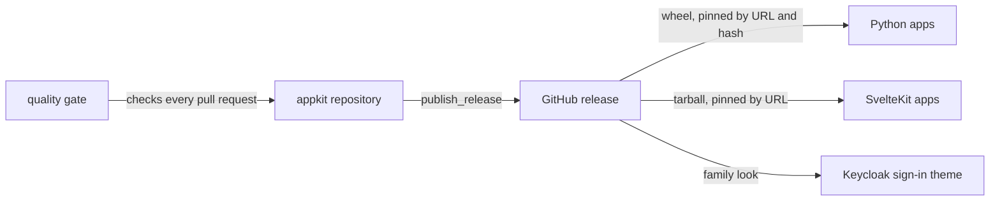
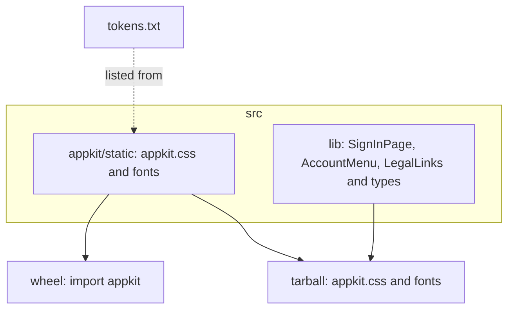
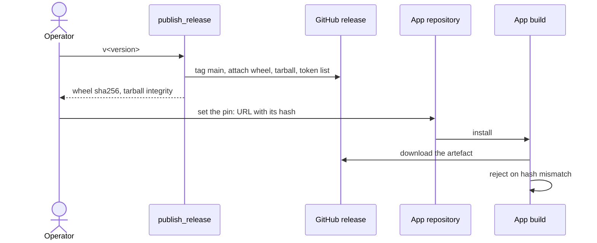

# appkit architecture

## 1. Context and Scope

appkit is the family look that overnightworks products share: one stylesheet,
its fonts and three Svelte components. It runs no service. Outside it: the
product apps that load the stylesheet (and, for SvelteKit apps, the components),
the Keycloak sign-in pages, which show the family look too, the GitHub release that
distributes it, and the shared quality gate that checks every pull request.
Page layout and product-specific JavaScript stay in the products.

## 2. Building Block View

One stylesheet source is packaged twice, so a Python app and a SvelteKit app
get identical CSS and fonts. The components exist only in the tarball.

- **Stylesheet and fonts** (`appkit.css`, `docs/stylesheet.md`): the family
  tokens, the `@font-face` rules and the classes `as-typed` and `legal`.
- **Components**: `SignInPage` and `AccountMenu` render the page and the panel,
  and both render `LegalLinks`. Each prop's meaning is a docstring in
  `src/lib/types.ts`.
- **Wheel**: the stylesheet and fonts for apps without a JavaScript bundler. It
  holds no `.svelte`.
- **Tarball**: the stylesheet, fonts and components; `svelte` is its only
  dependency, as a peer.
- **Token list**: the sorted custom-property names of the stylesheet, from
  `scripts/list_tokens`.

## 3. Runtime View

The core flow is how one change reaches every app.

## 4. Deployment View

appkit itself is not deployed. A GitHub release holds the artefacts. The apps'
builds download them: Python servers serve the wheel's `appkit.css`, and
SvelteKit builds bundle the tarball's stylesheet and components into the app.
In the browser the result is static CSS, fonts and component markup.

## 5. Crosscutting Concepts

**Trust.** appkit holds no secrets and handles no user data. What it ships is
static CSS, fonts and Svelte components, so the question is the supply path. A
tag never moves, so a release is immutable, and a consumer pins a URL together
with its content hash: the wheel's sha256 in the URL, the tarball's integrity in
the consumer's lockfile.

**Ownership of the components.** A component owns its markup and look. The app
owns what needs a decision about its product: routes, the trigger and popover
of the account menu, storing the theme and setting `data-theme`, how logging out
works, wording of failures, legal link targets, the app colour and loading
`appkit.css`. The components store, fetch and close nothing and write no
`data-theme`.

**Proof strategy.** CI runs `svelte-check` and vitest for the components, pytest
for the wheel, the tarball and `publish_release`, and ruff. Two Playwright
consumers are built for production from the packed tarball and paint the page
in a browser. The shared quality gate adds the secret scan, the
workflow-security scan and SonarCloud for CSS, HTML, Python and TypeScript. It
does not analyse `.svelte` files; the checks above and the gate's size ratchet
cover them.

## 6. Constraints and reasons

- The stylesheet and fonts exist once and are packaged in both forms, so no app
  sees a different look from its packaging.
- Tags never move; a broken release gets the next patch tag. A moved tag would
  change what a hash-pinned URL means.
- Pins carry a content hash, so a changed or substituted artefact fails the
  consumer's build instead of shipping.
- `svelte` is the tarball's only dependency, as a peer, so the app's own Svelte
  runs the components.
- `publish_release` builds everything before it tags, so a failed build leaves
  nothing to undo.

## 7. Not chosen

- An npm registry: `package.json` is `private`, and the tarball attached to the
  GitHub release is the only npm distribution.

## 8. Risks and Technical Debt

- SonarCloud does not analyse `.svelte` files.
- The Keycloak theme's way of taking the kit is not described here; the
  stylesheet reference only names its sign-in pages.
