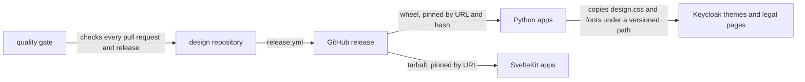
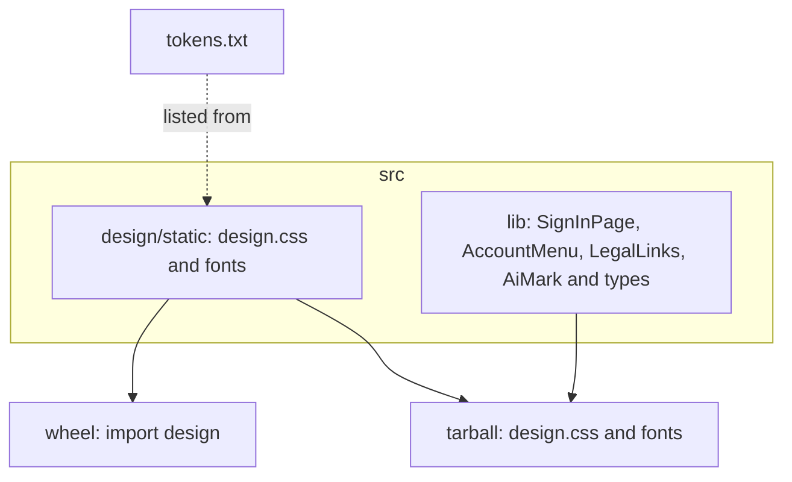
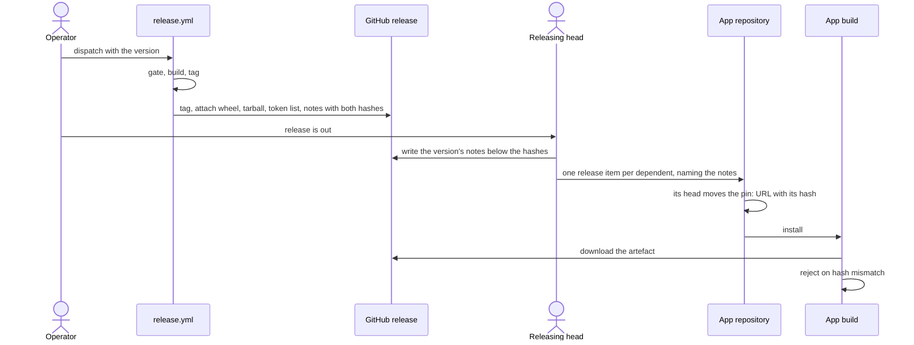

# design architecture

## 1. Context and Scope

design is the family look that overnightworks products share: one stylesheet,
its fonts and three Svelte components. It runs no service. Outside it: the
product apps that load the stylesheet (and, for SvelteKit apps, the components),
the Keycloak themes and the legal pages, which take the wheel's stylesheet and fonts through the
repository that builds them, the GitHub release that distributes it, and the shared quality gate that checks every pull request and every release.
Page layout and product-specific JavaScript stay in the products.

## 2. Building Block View

One stylesheet source is packaged twice, so a Python app and a SvelteKit app
get identical CSS and fonts. The components exist only in the tarball.

- **Stylesheet and fonts** (`design.css`, [`stylesheet.md`](stylesheet.md)): the family
  tokens, the `@font-face` rules and the classes `as-typed` and `legal`.
- **Components**: `SignInPage` and `AccountMenu` render the page and the panel,
  and both render `LegalLinks`. `AiMark` stands alone: the "AI" pill before an
  agent's name, with no props. Each prop's meaning is a docstring in
  [`src/lib/types.ts`](../src/lib/types.ts).
- **Wheel**: the stylesheet and fonts for apps without a JavaScript bundler. It
  holds no `.svelte`.
- **Tarball**: the stylesheet, fonts and components; `svelte` is its only
  dependency, as a peer.
- **Token list**: the sorted custom-property names of the stylesheet, from
  `scripts/list_tokens`.

## 3. Runtime View

The core flow is how one change reaches every app. The operator dispatches
`release.yml`; the [release step](../AGENTS.md) and what follows it are in
`AGENTS.md`.

## 4. Deployment View

design itself is not deployed. A GitHub-hosted runner builds the artefacts from
the gated commit, and a GitHub release holds them. The apps'
builds download them: Python servers serve the wheel's `design.css`, and
SvelteKit builds bundle the tarball's stylesheet and components into the app.
In the browser the result is static CSS, fonts and component markup.

## 5. Crosscutting Concepts

**Trust.** design holds no secrets. What it ships is static CSS, fonts and Svelte
components. The app passes the signed-in person's name, account URL and failure
text in; the components render them and keep none. So the question is the supply
path. GitHub enforces immutable releases for the organization, so a release's tag
and assets cannot change. A consumer pins a URL together with its content hash:
the wheel's sha256 in the URL, the tarball's sha512 integrity in the consumer's
lockfile, which pnpm writes only when it downloads the tarball and a frozen
install enforces. A release is built only from a commit that passed quality's
release gate, with no cache read, by a workflow whose actions are pinned to
commits and whose only write grant is the tag job's. The
[residuals of that path](https://github.com/overnightworks/quality/blob/main/docs/release.md#residual)
are quality's to name.

**Ownership of the components.** A component owns its markup and look. The app
owns what needs a decision about its product: routes, the trigger and popover
of the account menu, storing the theme and setting `data-theme`, how logging out
works, how a sign-in starts, wording of failures, legal link targets, the app colour and loading
`design.css`. The components store, fetch and close nothing and write no
`data-theme`.

**Proof strategy.** CI runs `svelte-check` and vitest for the components, pytest
for the wheel and the tarball, and ruff. The release gate and a check of the
built file list guard `release.yml`. Two Playwright
consumers are built for production from the packed tarball and paint the page
in a browser. The shared quality gate adds the secret scan, the
workflow-security scan and SonarCloud for CSS, HTML, Python and TypeScript. It
does not analyse `.svelte` files; the checks above and the gate's size ratchet
cover them.

## 6. Constraints and reasons

- The stylesheet and fonts exist once and are packaged in both forms, so no app
  sees a different look from its packaging.
- Releases are immutable, enforced by GitHub; a broken release gets the next
  patch tag.
- Pins carry a content hash, so a changed or substituted artefact fails the
  consumer's build instead of shipping.
- `svelte` is the tarball's only dependency, as a peer, so the app's own Svelte
  runs the components.
- `release.yml` builds everything before it tags, so a failed build leaves
  nothing to undo.

## 7. Not chosen

- A custom element, or pages the kit renders on the server, instead of Svelte
  components: every app is on one stack, SvelteKit, and non-Svelte consumers (the
  Keycloak themes and the legal pages) take only the stylesheet. Reopens if an app that cannot run
  Svelte needs a component.
- Each consumer keeping its own copy of a shared rule set, such as the legal
  row's CSS: copies drift, so one rule set lives in `design.css`. Reopens only if
  a consumer cannot load `design.css`.
- A template fragment the kit ships for one provider (a Keycloak FTL or HTML
  fragment): it carries one provider's template format for one consumer and still
  needs the rules in the stylesheet, so such a page writes the documented markup.
  Reopens if several consumers share one template format.
- Git pins (`github:overnightworks/design#vX.Y.Z`) instead of release assets: a
  git pin loses the content hash a consumer's lock checks, sha256 in the wheel
  URL and sha512 in pnpm's lock. Reopens if a git pin can carry a checked content
  hash.

## 8. Risks and Technical Debt

- SonarCloud does not analyse `.svelte` files.
