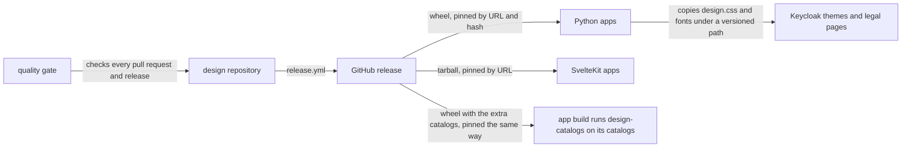
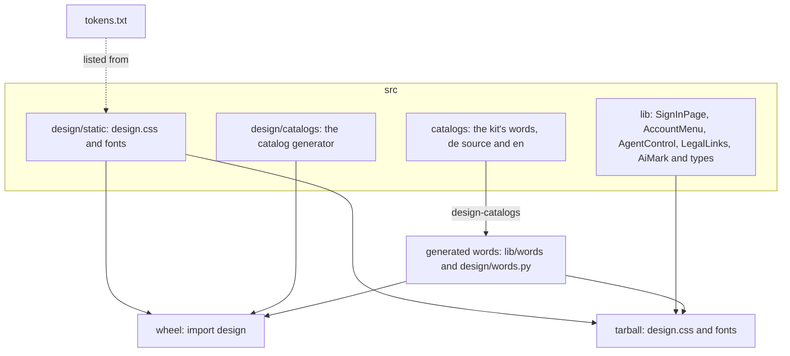
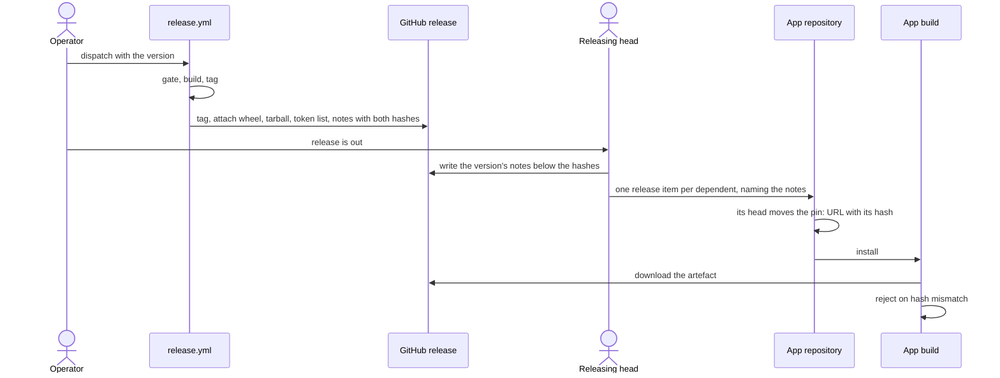

# design architecture

## 1. Context and Scope

design is the family look that overnightworks products share: one stylesheet,
its fonts and five Svelte components, and the generator that turns an app's
translation catalogs into modules. It runs no service. Outside it: the
product apps that load the stylesheet (and, for SvelteKit apps, the components),
the Keycloak themes and the legal pages, which take the wheel's stylesheet and fonts through the
repository that builds them, the GitHub release that distributes it, and the shared quality gate that checks every pull request and every release.
Page layout and product-specific JavaScript stay in the products.

## 2. Building Block View

One stylesheet source is packaged twice, so a Python app and a SvelteKit app
get identical CSS and fonts. The components exist only in the tarball.

- **Stylesheet and fonts** (`design.css`, [`stylesheet.md`](stylesheet.md)): the family
  tokens, the `@font-face` rules and the classes `as-typed` and `legal`.
- **Components**: `SignInPage` and `AccountMenu` render the page and the panel,
  and both render `LegalLinks`. `AgentControl` is the panel of rows with which a
  person calls an agent and asks it to leave; each row leads with `AiMark`, the
  "AI" pill before an agent's name, which takes no props. The app owns the
  trigger and the popover, and the control holds no state of the call. Each prop's meaning is a docstring in
  [`src/lib/types.ts`](../src/lib/types.ts).
- **Catalog generator** (`design.catalogs`, [`languages.md`](languages.md)): the
  command `design-catalogs` reads an app's gettext catalogs and writes a typed
  TypeScript module per language and, if the app declares one, a Python module;
  `--check` fails on a broken catalog or a module that is stale. The optional table
  `[tool.design-catalogs]` in the app's root `pyproject.toml` names the source
  language and the paths. It is in the wheel only, behind the extra `catalogs`
  (Babel), and runs at build time, never in a server or a browser.
- **The kit's words** (`src/catalogs`): the catalogs are the one source of two
  outputs, `src/lib/words` for the tarball and `src/design/words.py` for the wheel,
  which the kit's own `design-catalogs` generates and `--check` gates in CI. The
  catalogs belong to neither `src/lib` nor `src/design` and ship in neither
  artefact. The package root exports the generated loader as `loadKitWords`, with
  the types `KitWords` and `KitLanguage`; the loader takes the language its caller
  passes and the kit reads none itself. The Python module is for an app's tests,
  not its server, and needs no Babel.
- **Wheel**: the stylesheet and fonts for apps without a JavaScript bundler, the
  generator and the kit's Python words. It holds no `.svelte`.
- **Tarball**: the stylesheet, fonts, components and the kit's words per language,
  each language its own chunk; `svelte` is its only dependency, as a peer.
- **Token list**: the sorted custom-property names of the stylesheet, from
  `scripts/list_tokens`.

## 3. Runtime View

The core flow is how one change reaches every app. The operator dispatches
`release.yml`; the [release step](../AGENTS.md) and what follows it are in
`AGENTS.md`.

## 4. Deployment View

design itself is not deployed. A GitHub-hosted runner builds the artefacts from
the gated commit, and a GitHub release holds them. The apps'
builds download them: Python servers serve the wheel's `design.css`, and
SvelteKit builds bundle the tarball's stylesheet and components into the app.
In the browser the result is static CSS, fonts and component markup.

## 5. Crosscutting Concepts

**Trust.** design holds no secrets. What it ships is static CSS, fonts and Svelte
components. The app passes the signed-in person's name, account URL and failure
text in; the components render them and keep none. So the question is the supply
path. GitHub enforces immutable releases for the organization, so a release's tag
and assets cannot change. A consumer pins a URL together with its content hash:
the wheel's sha256 in the URL, the tarball's sha512 integrity in the consumer's
lockfile, which pnpm writes only when it downloads the tarball and a frozen
install enforces. A release is built only from a commit that passed quality's
release gate, with no cache read, by a workflow whose actions are pinned to
commits and whose only write grant is the tag job's. The
[residuals of that path](https://github.com/overnightworks/quality/blob/main/docs/release.md#residual)
are quality's to name.

**Trust of the generator.** It runs in an app's build on that app's own committed
catalogs, which are as trusted as its code. It reads no network and no secret.
A catalog text is quoted into the modules, as a JSON string in TypeScript and with
`repr` in Python, so no text can leave its literal.

**Ownership of the components.** A component owns its markup and look. The app
owns what needs a decision about its product: routes, the trigger and popover
of the account menu, storing the theme and setting `data-theme`, how logging out
works, how a sign-in starts, wording of failures, legal link targets, the app colour and loading
`design.css`. The components store, fetch and close nothing and write no
`data-theme`.

**Proof strategy.** CI runs `svelte-check` and vitest for the components, pytest
for the wheel, the tarball and the generator, with 100 % branch coverage of
`src/design`, and ruff. The generated TypeScript is run in Node and type-checked,
the generated Python is imported and passed through ruff, and the pin by hash is
proven by installing the built wheel through a URL with a wrong sha256, which
fails. The release gate and a check of the
built file list guard `release.yml`. Two Playwright
consumers are built for production from the packed tarball and paint the page
in a browser. The shared quality gate adds the secret scan, the
workflow-security scan and SonarCloud for CSS, HTML, Python and TypeScript. It
does not analyse `.svelte` files; the checks above and the gate's size ratchet
cover them.

## 6. Constraints and reasons

- The stylesheet and fonts exist once and are packaged in both forms, so no app
  sees a different look from its packaging.
- Releases are immutable, enforced by GitHub; a broken release gets the next
  patch tag.
- Pins carry a content hash, so a changed or substituted artefact fails the
  consumer's build instead of shipping.
- `svelte` is the tarball's only dependency, as a peer, so the app's own Svelte
  runs the components.
- `release.yml` builds everything before it tags, so a failed build leaves
  nothing to undo.

## 7. Not chosen

- A custom element, or pages the kit renders on the server, instead of Svelte
  components: every app is on one stack, SvelteKit, and non-Svelte consumers (the
  Keycloak themes and the legal pages) take only the stylesheet. Reopens if an app that cannot run
  Svelte needs a component.
- Each consumer keeping its own copy of a shared rule set, such as the legal
  row's CSS: copies drift, so one rule set lives in `design.css`. Reopens only if
  a consumer cannot load `design.css`.
- A template fragment the kit ships for one provider (a Keycloak FTL or HTML
  fragment): it carries one provider's template format for one consumer and still
  needs the rules in the stylesheet, so such a page writes the documented markup.
  Reopens if several consumers share one template format.
- The generator as a script in the npm tarball: it would carry Python inside an
  npm package with no dependency resolution, so every app would declare Babel
  itself and the copies would drift. Reopens only if an app cannot install the
  wheel in its build.
- Babel as a plain dependency of the wheel: its locale data would reach every
  Python server that takes the wheel only for `design.css`, so Babel stays behind
  the extra `catalogs`.
- Babel's catalog update, and a hash of the source text, for freshness: the update
  matches entries by text across keys and drops plural categories the source lacks,
  and a hash records what a translation's `msgid` already holds, readably. A
  translation is current when its `msgid` equals the source's text for its key.
- Every language bundled in the components behind a `language` prop: every app
  would ship all languages, and a component would choose one itself.
- Per-language records under the components' `*Words` props, a Svelte context
  and a component that loads its own words: each hides where the app's language
  is decided, which the app owns (LANG-17).
- The app's generator merging the kit's words from the installed wheel into the
  app's modules: one load call and no pin skew, but an app build coupled to the
  wheel version, a rule against key collisions and the generator as a
  precondition for taking the kit.
- Git pins (`github:overnightworks/design#vX.Y.Z`) instead of release assets for
  the npm package and the wheel as a runtime dependency: a git pin loses the
  content hash a consumer's lock checks, sha256 in the wheel URL and sha512 in
  pnpm's lock. Reopens if a git pin can carry a checked content hash. The
  generator, a dev dependency, may be taken by git tag, which `uv lock` records
  as a commit.

## 8. Risks and Technical Debt

- SonarCloud does not analyse `.svelte` files.
