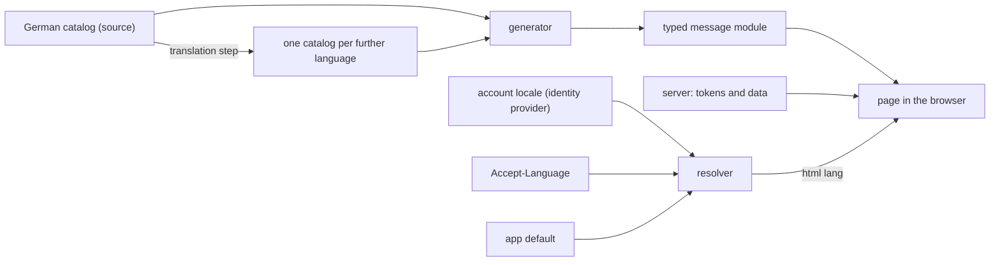

# Languages

The standard by which every app is built so that a further language is added without a
rebuild. Read it when you cut an app's epic for it, build against it or judge an app's
conformance. A rule is cited by its ID, such as `LANG-9`.

This document is a requirement. The shared generator, the shared resolver, the shared checks,
the test helpers and the kit's per-language words do not exist yet. The owner's release that
ships each one makes the rules that need it checkable.

Source: the operator's rulings on overnightworks/marketplace#542. A rule marked **ruled**
quotes one; a rule marked **proposed** is this document's proposal, judged by plan review,
and changes with it.

**Done** means a further language is a new catalog file and its translations. No code changes.
Around the app it also takes the kit's catalog for that language, the identity provider's
locale and the legal reading versions: configuration and texts, not code.

## Scope and owners

- **Covered:** every app with a user-facing surface (skat, hopin, songmaker, presentator) and
  the kit (design) for its components' words.
- **design** owns this standard, the generator, the translation step and the language resolver.
- **quality** owns the check rule that enforces it.
- **platform** owns the legal pages and the identity provider's locales and pages.
- **The sign-in wiring (webauth)** hands the account's language to the app.
- **Speech** hears `de` or `en`, one per session, and speaks German. A choice per utterance
  and further spoken languages are open in overnightworks/speech#279.

## How the parts meet

## Requirements

### Ruled

- **LANG-1** (line 1) Each language has one gettext catalog. A generated, typed message
  module is the only way a page reads a text. The server sends message tokens. Checks hold
  all of it.
- **LANG-2** (line 2) A person's language is the account's locale at the identity provider,
  else the browser's. The sign-in wiring hands it to the app.
- **LANG-3** (line 3) The kit ships its components' words in every language. This replaces
  the kit's earlier rule that it holds no language, and an English sign-in page is no
  longer acceptable.
- **LANG-4** (line 5) The German version of a legal text binds. Each further language gets a
  reading version that says so. A lawyer checks the approach before the first one ships.
- **LANG-5** (line 6) An agent answers and speaks in the language the person wrote or asked
  in. No app fixes a language for its agents.
- **LANG-6** (added requirement, with a newer word) A model writes each translation once from
  the German source, to the best of its knowledge. No human review is a condition, and no
  check blocks a build for a missing sign-off. A correction comes later as an ordinary
  change. A check fails when a translation is older than its source.
- **LANG-7** (added requirement) Behaviour tests run in one language and find elements by
  catalog key. A further language costs a static catalog check and one render pass per
  surface.

### Proposed: catalogs and texts

- **LANG-8** The generator, the translation step, the freshness check, the resolver
  (LANG-18) and the test helpers (see Tests) live in design and ship in its releases. The
  check rule that calls them lives in quality (line 7). Rejected: everything in quality,
  which gates a build and does not produce the app's source; a copy per app, where the
  copies drift (skat and presentator hold the first ones today, and the shared tools
  replace them).
- **LANG-9** A catalog key is a neutral identifier that names what the text is for, never
  the sentence, namespaced by surface (`table.seatFree`). Renaming a key changes every
  catalog. Rejected: flat keys, which collide at a thousand texts. A value is a whole
  sentence, never assembled from fragments: where it varies, it names its gaps (`{name}`),
  and the typed module types each gap.
- **LANG-10** A language is whole or absent. A key missing from a catalog fails the check;
  no text falls back to another language one by one.
- **LANG-11** Numbers, dates, lists and plural forms go through the browser's `Intl` with the
  page's language. A plural is a family of whole sentences, one per `Intl.PluralRules`
  category (`.one`, `.other`). One form for the fleet. Rejected: gettext plural forms, which
  restate rules the browser already knows. A translation holds the categories its own
  language needs, so a family is the one place its key set may differ from the source's.
- **LANG-12** The server sends tokens (a catalog key and named values) and data, never a
  sentence for a person. A token the server can send is a key of the catalog. Tool
  descriptions for agents and log lines are not interface text.
- **LANG-13** A text that is stored, such as a failure message in a database, stores its
  token and data, never the sentence; the page renders it in the reader's language.
- **LANG-14** An app has one catalog per language, read by both sides. The server reads it
  only for a page that needs no script (LANG-20), through a typed module the generator also
  emits for it. Rejected: a second catalog for the server, which doubles the source of truth
  and the freshness check.
- **LANG-15** The generator emits one typed module per language, and the key type comes
  from the source module. The page loads the module of the language in `<html lang>`, once,
  when it starts. Rejected: one module holding every language, which ships every language
  to every person.

### Proposed: the person's language

- **LANG-16** A language tag is BCP 47 in shape, nothing narrower in transport. The
  languages an app offers are its catalog files, nothing else. A tag matches a catalog
  exactly, else by its base language (`de-AT` finds `de`). A tag that is malformed, unknown
  or unsupported counts as absent. Rejected: a fleet list of languages, which makes each
  new language a change to every app.
- **LANG-17** The sign-in wiring hands the app the account's tag as the identity provider
  issued it (its `locale` claim), or a named absence. It does not interpret it.
- **LANG-18** One pure function owns the order: the account's tag or none, the browser's
  `Accept-Language` header with its weights, and the app's languages give one of the app's
  languages. Order: account, then browser, then the app's default. The default is the
  source language unless the app states another. The function exists once, in design
  (LANG-8), and the sign-in page and every page after sign-in call it. Rejected: webauth,
  which every server carries but would then own header parsing that is not sign-in; a copy
  per app, which parses a weighted header four times.
- **LANG-19** The account's tag is read at sign-in. A change at the identity provider takes
  effect at the latest at the next sign-in.
- **LANG-20** The server writes the resolved language into `<html lang>` before any script
  runs. A page that needs no script is served once per language from the same catalog.
- **LANG-21** At sign-in start the app names its resolved language to the issuer as
  `ui_locales` (OpenID Connect Core 1.0, section 3.1.2.1), so the identity provider's own
  pages follow it. The issuer's own choice differs from the app's only when the browser names
  no language the issuer offers and the app falls back to its default. Rejected: sending
  nothing, which leaves that case in the issuer's default. Not verified: whether the issuer
  lets the account's locale override the hint, a fact of platform's realm.

### Proposed: kit, content, source and freshness

- **LANG-22** The kit's components take the page's language and bring their words for it.
  Today they take the words from the app and render English without them; that is the
  state this rule replaces. An app's check fails when the kit lacks a language the app
  offers. The kit's own conversion is a separate epic that follows this document.
- **LANG-23** Content never follows the interface language: lyrics, slides, chat messages
  and names. Where an app needs content's own language (for example to mark a span with
  `lang`), the content carries a tag of its own. An agent's reply follows the message that
  caused it (LANG-5); when no message did, such as a click, it follows the person's
  interface language. An app builds no language rule into an agent that already answers in the
  person's language.
- **LANG-24** German is the source language (LANG-6). An app whose texts are English today
  converts to a German source or asks for a deviation (see Deviations). Only the operator
  rules a deviation. Wherever this document says "the German catalog" or "the source", an
  app with a ruled deviation reads its own source catalog.
- **LANG-25** Freshness is a recorded source hash. Each translated entry carries the hash of
  the German text it was produced from; the check fails when it differs from the current
  German text, and running the translation step for that entry clears it. The mark records
  staleness only; it never waits for a person. Rejected: gettext's fuzzy mark, which means
  "awaits a human" and which `msgmerge` never sets anyway, because a changed German text
  does not change a key that is a name. The translation engine is not decided here. The
  committed catalog is the build's input, so the build needs no network and no key.
- **LANG-26** Legal texts follow LANG-4. platform owns the pages and each reading version.

## Tests

One question governs this section: what does a further language add that a test must see?

- **Behaviour tests run in the source language.** They find elements by catalog key, never by
  the words on screen. The test reads the catalog text through a helper, one in Python and one in
  TypeScript (Playwright, Vitest), shipped by design with the generator and never copied
  per app (skat's `tests/e2e/support/words.py` is the reference). A test that passes in one language
  passes in all, because the flow does not change with the words.
- **Static checks run per catalog**, in CI, without a browser:
  - the key set equals the source's, and each value's named gaps equal the source's;
  - no entry is stale (LANG-25);
  - the generated module is current;
  - every token the server can send is a key (LANG-12);
  - the kit holds the language (LANG-22);
  - the markup check: no page, in a text or in a human-readable attribute, carries a literal
    sentence (presentator's `scripts/check_catalog_purity.py` is the reference). It runs
    with a baseline that only shrinks.
- **One render pass per surface and width for a further language.** Each surface renders in
  that language at the mobile and the desktop width. It shows no missing key, nothing
  clipped or overflowing (translations run longer), and `<html lang>` carries the language.
- **Tested once, in design:** the resolver (LANG-18), the generator and the freshness check.
  An app tests only that it calls the resolver and writes `<html lang>`.
- **Not tested per language:** flows, permissions, state, and the browser's `Intl` output.
  The wording of a translation is corrected later as an ordinary change (LANG-6).

## Adoption trigger

Every covered app holds an open epic now. The rule for new text binds at once: no new
literal sentence in markup, no sentence from the server. Apps that can convert quickly do so
at once. songmaker starts too.

The first slice every app takes: the catalog and the shared generator in place, one surface
converted, and the markup check running with a baseline that shrinks. Later slices convert
the surfaces and the server's sentences into tokens, then add the first further language.

## Deviations

A deviation is asked for at design, as marketplace's `docs/standards.md` ("How a standard
works") requires. The request names enduring harm: a lost capability, recurring upkeep, an
unmet operational constraint or a credible risk, with its uncertainty stated. design's head
reviews it. Only the operator rules it, and the ruling is recorded here.

Ruled today (source: songmaker#2976, line 1): songmaker keeps English as its source
catalog, and German is generated from it as its first added language. Its keys are neutral
identifiers (LANG-9), so the source can change later without a code change. For any other
app whose texts are English today, nothing is ruled: German as the source stands until the
operator rules a deviation.
