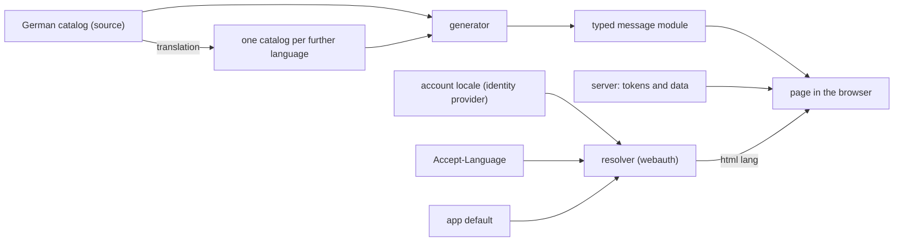

# Languages

The standard by which every app is built so that a further language is added without a
rebuild. Read it when you cut an app's epic for it, build against it or judge an app's
conformance. A rule is cited by its ID, such as `LANG-9`.

This document is a requirement. Each rule becomes checkable with the owner's release that
ships its part.

Source: the operator's rulings on overnightworks/marketplace#542, overnightworks/design#162 and
overnightworks/design#168.
A rule marked **ruled** quotes one; a rule marked **proposed** is this document's proposal,
judged by plan review, and changes with it.

**Done** means a further language is a new catalog file and its translations. No code changes.
Around the app it also takes the kit's words for that language, the identity provider's
locale and the legal reading versions: configuration and texts, not code.

## Scope and owners

- **Covered:** every app with a user-facing surface (skat, hopin, songmaker, presentator) and
  the kit (design) for its components' words.
- **design** owns this standard and the generator.
- **webauth** owns handing the account's language to the app and the language resolver.
- **quality** owns the check rule that enforces it.
- **platform** owns the legal pages and the identity provider's locales and pages.
- **Speech:** LANG-5 binds speech too; what is open for it is in overnightworks/speech#279.

## How the parts meet

## Requirements

### Ruled

- **LANG-1** (line 1) Each language has one gettext catalog. A generated, typed message
  module is the only way a page reads a text. The server sends message tokens. Checks hold
  all of it.
- **LANG-2** (line 2) A person's language is the account's locale at the identity provider,
  else the browser's. The sign-in wiring hands it to the app. No app stores a person's
  language or offers its own language switch; the person changes it at the identity
  provider's account.
- **LANG-3** (line 3) The kit ships its components' words in every language, the sign-in
  page, the no-access page and the account menu's log-out included.
- **LANG-4** (line 5) The German version of a legal text binds. Each further language gets a
  reading version that says so. To be checked legally before the first one ships.

  **Ruled (design#162 line 1):** the approach (the German version binds, reading versions say
  so) is checked legally once before the first reading version ships. The reading versions are
  translated by a model like every other text (LANG-6), with no human review as a condition.
- **LANG-5** (line 6) An agent answers and speaks in the language the person wrote or asked
  in. No app fixes a language for its agents.
- **LANG-6** (added requirement, with a newer word) A model writes each translation once from
  the German source, to the best of its knowledge. No human review is a condition, and no
  check blocks a build for a missing sign-off. A correction comes later as an ordinary
  change. A check fails when a translation is older than its source.
- **LANG-7** (added requirement) Behaviour tests run in one language and find elements by
  catalog key. A further language costs a static catalog check and one render pass per
  surface.

### Proposed: catalogs and texts

- **LANG-8** What is used as is: Babel reads the `.po` files and gives the CLDR plural
  categories per language; the browser's `Intl` formats numbers, dates, lists and plurals.
  What is built: one thin generator (several languages, typed named gaps, plural families, a
  TypeScript and a Python module, `--check`) and webauth's small resolver (LANG-16). No
  translation tool and no test helpers. The generator ships in design's Python wheel, used at
  build time only, with Babel as its dependency. The check rule that requires it lives in
  quality (line 7). Libraries weighed and rejected:
  - Paraglide JS: no gettext `.po`, so it fails line 1; Python reads its messages only as raw
    JSON.
  - Lingui: reads `.po` and emits typed modules, but puts ICU syntax into `msgstr`, which
    Python cannot format without a C++ binding, and adds a runtime and macro dependency to
    every app.
  - inlang's CLI: no stale check; its machine translation needs a provider key.

  Also rejected: a copy per app, where the copies drift; the resolver in design's wheel, which
  adds a runtime edge to every app server and a webauth-to-design direction, while every app
  server already depends on webauth.

  **Ruled (design#162 line 3):** the generator with its catalog checks ships from design; the
  language resolver lives in webauth; the markup scan and the rule that requires the checks live
  in quality. The libraries and the rejected alternatives stay proposed.
- **LANG-9** A catalog key is a neutral identifier that names what the text is for, never the
  sentence: one namespace level, the surface, then a camelCase name (`table.seatFree`). A
  text on two surfaces gets two keys. The kit's words never enter an app catalog. Renaming a
  key changes every catalog. Rejected: flat keys, which collide at a thousand texts. A value
  is a whole sentence, never assembled from fragments: where it varies, it names its gaps
  (`{name}`), and the typed module types each gap. An entry of a plural family adds a dot and
  its CLDR plural category (`table.seats.one`); a family's key is its entries' `msgctxt`
  without the category, and a plain key equal to a family's key fails the check.
- **LANG-10** A language is whole or absent. A key missing from a catalog fails the check;
  no text falls back to another language one by one.
- **LANG-11** Numbers, dates, lists and plural forms go through the browser's `Intl` with the
  page's language. A page without script holds no number, date or list. Its plural families
  are chosen by a plural function that the generator writes into the Python module at build
  time from Babel's CLDR rules, for whole-number counts, so no server needs Babel at runtime.
  A plural is a family of whole sentences, one per CLDR plural category (`.one`, `.other`).
  One form for the fleet. Rejected: gettext plural forms, which restate rules the CLDR data
  already holds; ICU MessageFormat, a second syntax inside gettext with no maintained Python
  parser for the generator. A catalog's key set equals the source's, except that a plural
  family holds exactly the categories its own language needs (CLDR plural categories, read
  through Babel, and `other`); a catalog in a language Babel has no rules for fails the check
  only where a plural family needs the categories, and the message names the catalog file.
  Every entry of a family carries the same gaps, except that a category's sentence may leave
  out `{count}` (`Ein Platz frei` beside `{count} Plätze frei`).

  A gap is a plain identifier in braces, `{name}`; `__proto__` is refused, because in an
  object literal it sets the prototype instead of a value. A literal brace is written `{{` or
  `}}`, and the module holds the single brace. A gap named `count` takes a number and is
  formatted with `Intl.NumberFormat` of the module's language; every other gap takes a string.
  A text with gaps is a function of one gaps object, `words["chat.greeting"]({ name, count })`.
  A family is one function `(count: number, gaps) => string`, called `words["table.seats"](3,
  { name })`: the count is its own argument, so the number that chooses the sentence is the
  number it shows, and the gaps object stands only where the family has a gap besides
  `count`. The module holds one `Intl.PluralRules` of its language and chooses the sentence by
  `select(count)`; a category the family lacks falls to `other`. The token and the TypeScript key
  of a family are its key. A module that adds, renames or drops a gap, or
  lacks a key, fails the type check against the source's module; the generator's check refuses
  the same before it writes one. The count is the exception: a family's `count` is its argument,
  not a gap of the type, so a category's sentence may leave out `{count}`, in the source and in a
  translation, and both the type check and the catalog check accept it; the catalog check
  refuses any other gap that is dropped or added.

  In the Python module `text(language, key, /, **gaps)` fills the gaps of a plain key, reads
  `{{` and `}}` as single braces and raises on a missing or an unknown gap. A family is named
  by its family key, `text(language, "table.seats", count=3, **gaps)`:
  `plural_category(language, count)` chooses the sentence, a category the family lacks falls
  to `other`, and `count` fills the gap of that name, so the number that chooses is the
  number shown. The categories are no keys of the module. `plural_category` is written into
  the module at build time from Babel's CLDR rules, for whole counts, and equals
  `babel.plural.to_python` for every locale Babel ships; no server needs Babel at runtime.
  The Python module writes `count` as plain digits, because the grouping and the digit shapes
  of `Intl.NumberFormat` need the CLDR data of the language at run time, so a count of 1000
  or more reads differently there than on the page where the language groups digits. Babel's
  CLDR release and the browser's differ for some smaller languages, so a family is checked
  against Babel's categories; where the page's `Intl.PluralRules` gives such a language a
  category the family lacks, the sentence falls to `other`.
- **LANG-12** The server sends tokens (a catalog key and named values) and data, never a
  sentence for a person. A response may carry a sentence for agents beside the token; the
  page never shows it. The token has one shape in every app: a field `message` holding `key`
  and `values`, beside the field that carries the sentence for agents where the response has
  one. The shape holds where a response carries a text for the person; a domain token that
  the page maps to its own key (a refusal's reason, a game's ending) is data and needs no
  `message` field. Tool descriptions for agents and log lines are not interface text.
- **LANG-13** A text that is stored, such as a failure message in a database, stores its
  token and data, never the sentence; the page renders it in the reader's language.
- **LANG-14** An app has one catalog per language, read by both sides. The generator emits
  one TypeScript module per language, whose key type comes from the source module, and a
  Python module where the server sends tokens, serves a script-less page (LANG-17) or a
  Python test reads texts. It also writes a loader, `index.ts`, beside the language modules:
  `languages`, `Language`, `sourceLanguage` and `loadWords(language)`, which imports the
  language's module on demand, so the list of languages always equals the catalog files. The
  app reads `<html lang>` and calls the loader once, when it starts. Server tokens are typed
  against the module's key type, so that every token the server can send is a key. Rejected:
  a second catalog for the server, which doubles the source of truth and the freshness check;
  one module holding every language, which ships every language to every person.

### Proposed: the person's language

- **LANG-15** The sign-in wiring hands the app the account's tag as the identity provider
  issued it (its `locale` claim), or a named absence, and does not interpret it; the tag is
  read at sign-in, so a change at the identity provider takes effect at the latest at the next
  sign-in.
- **LANG-16** One pure function in webauth owns the order: the account's tag or none, the
  browser's `Accept-Language` header and the app's languages give one of the app's languages.
  It matches by RFC 4647 Lookup (section 3.4) over the account's tag, then the browser's
  weighted list (RFC 9110, section 12.5.4), then the app's default, which is the source
  language unless the app states another. It answers one of the app's own language tags as the
  app spelled it (`de-AT` finds `de`). A tag is BCP 47 in shape; a tag it cannot parse, and
  one that matches none of the app's languages, counts as absent. The languages an app offers
  are its catalog files, nothing else. The sign-in page and every page after sign-in call it.
  webauth owns the ID token's `locale` claim and the sign-in request that carries
  `ui_locales`. Rejected: a fleet list of languages, which makes each new language a change to
  every app; a copy per app, which parses a weighted header four times; design's wheel
  (LANG-8).
- **LANG-17** The server writes the resolved language into `<html lang>` before any script
  runs. A page that needs no script is served once per language from the same catalog.
- **LANG-18** At sign-in start the app names its resolved language to the issuer as
  `ui_locales` (OpenID Connect Core 1.0, section 3.1.2.1), so the identity provider's own
  pages follow it. Those pages differ from the app's language only when that language is not
  among the realm's supported locales; adding a language adds it there (platform).

### Proposed: kit, content, source and freshness

- **LANG-19** The kit ships its components' words per language as the generator's modules and
  loader. The app loads them with `loadKitWords` for the page's language, as it loads its own,
  and passes them to every kit component; a component reads no language itself. The app passes
  its generated `Language`, never a literal or a cast, and its words module carries the line
  `languages satisfies readonly KitLanguage[]`, so the app's type check fails when it offers a
  language the kit lacks. The components take these words in the release after the one that
  ships them.
- **LANG-20** Content never follows the interface language: lyrics, slides, chat messages
  and names. Where an app needs content's own language (for example to mark a span with
  `lang`), the content carries a tag of its own. An agent's reply follows the message that
  caused it (LANG-5); where no message did, such as a click, the app passes the person's
  interface language to the agent. That is no language rule inside the agent's prompt.
- **LANG-21** German is the source language (LANG-6). An app whose texts are English today
  converts to a German source or asks for a deviation (see Deviations). Wherever this
  document says "the German catalog" or "the source", an app with a ruled deviation reads its
  own source catalog.
- **LANG-22** A catalog entry is gettext's standard shape, keyed in `msgctxt`. The source
  language's file holds each key with its text in `msgid` and an empty `msgstr`. A
  translation's file holds the same `msgctxt`, the source text it was translated from as
  `msgid`, and the translation in `msgstr`. Every catalog, the source's included, carries a
  `Language` header equal to its file stem, which is the BCP 47 tag (`pt-BR`), not the POSIX
  form (`pt_BR`) that gettext tools write; the check fails on a catalog without it. A plural category the source lacks takes the
  source's `other` text as its `msgid`. Freshness is a comparison by key, never Babel's
  catalog update, which matches entries by text across keys and drops categories the source
  lacks. The check fails when a translation's key set differs from the source's (LANG-11),
  when an entry is empty (a `msgstr` of whitespace only is empty) or fuzzy, or when a translation's `msgid` differs from the source's
  current text for its key. The generator's sync (`design-catalogs --sync`) brings a translation in
  line by key: it adds missing keys with the source text as `msgid` and an empty `msgstr`, sets
  a changed `msgid` to the source's text, keeps the old `msgstr` and marks it fuzzy, removes
  keys the source dropped, and gives a plural family exactly the categories of its language.
  It keeps the header, the order of the entries and the comments and flags of the entries it keeps,
  writes nothing for a catalog that already follows its source (the README names what Babel's
  writer normalises in one it rewrites), and writes catalogs only: the modules follow from
  `design-catalogs` once the translations are written, so a change goes in the order sync,
  translate, generate, check. Fuzzy means "stale,
  to be re-translated", not "awaits a human" (LANG-6). The agent that changes a source text
  runs the sync, writes the translations and clears the marks in the same change; nothing
  needs a network, key or provider, and the committed catalog is the build's input. The
  remaining risk: clearing a mark without translating defeats the check, which is an aid for
  cooperative agents.
- **LANG-23** Catalogs live at `frontend/src/lib/catalogs/<tag>.po` and
  generated modules beside the code that imports them, unless the repository's one
  declaration, which the generator and quality's rule read, names other paths. The
  declaration is the optional table `[tool.design-catalogs]` in the root `pyproject.toml`
  (design's README). A file in the module directory that no catalog
  produces is a stray, which `--check` fails; a dotfile (`.gitkeep`) is no stray.
- **LANG-24** The rule for new text: no new literal sentence in markup, no sentence from the
  server. Literal strings in script (toasts, confirm dialogs) are bound by it too, but no
  machine catches them; the scheduled audit finds them.

## Tests and checks

One question governs this section: what does a further language add that a test must see?

- **Behaviour tests run in the source language.** A behaviour test never finds an element by
  a literal; the expected text comes from the generated module of the source language, by
  key. No app parses a catalog in a test, and no test helper ships.
- **One owner per check.** The generator's `--check` holds all catalog validity and runs in
  the app's own lint and in CI:
  - the key set equals the source's, except that a plural family holds exactly the categories
    of its own language and the same gaps in every entry but the count (LANG-11);
  - no entry is empty or fuzzy, and every catalog's `Language` header equals its file stem
    (LANG-22);
  - each translation's `msgid` equals the source's text for its key (LANG-22);
  - each value's named gaps equal the source's, and no key is missing (LANG-10);
  - the generated modules and the loader are current.

  The type check holds the rest of the key contract: server tokens are typed against the
  module's key type (LANG-14), and the kit ships every language the app offers, by the line
  `languages satisfies readonly KitLanguage[]` (LANG-19).
- **quality's rule** (a) requires the `--check` in the app's CI and the render pass below, and
  (b) owns the scan for literal text in markup, in a text or in a human-readable attribute
  (presentator's `scripts/check_catalog_purity.py` is the reference), with a baseline that
  only shrinks.
- **The render pass.** An automated test of the app that runs in CI on every change, per
  further language, at the mobile and the desktop width. It asserts that no catalog key
  appears as text, `<html lang>` equals the language, and no text element's scroll width
  exceeds its client width unless it scrolls by design. quality requires its presence. A
  delegated agent drives the surfaces once when a language is added.
- **Tested once, outside the app:** the resolver (LANG-16), the generator and the freshness
  check. An app tests only that it calls the resolver and writes `<html lang>`.
- **Not tested per language:** flows, permissions, state, and the output of `Intl`.
  The wording of a translation is corrected later as an ordinary change (LANG-6).

## Adoption trigger

**Ruled (line 4):** every covered app holds an epic. Apps that can convert quickly do so now.
songmaker starts too.

**Proposed:** design ships the shared generator first (skat's generator moved into design and
widened to LANG-9 to LANG-11). An app's first catalog slice follows that release, and no app
extends a generator of its own meanwhile. An app may start these slices before that release:
server sentences to tokens against a typed key list, one owner for the date and sort locale.
An app whose responses must keep a sentence for agents moves its server sentences to tokens
once the generated key type exists, so it builds no key list by hand.

**Ruled (design#162 line 2):** the rule for new text (LANG-24) binds an app from its first
catalog slice; until then, new texts go into one named constants owner per app.

**Ruled (design#168 line 2):** a new interface text goes into the app's frontend constants owner;
a new server sentence is a named constant in its module until that module moves to tokens.

An app's slices after the first convert the surfaces and the server's sentences into
tokens, then add the first further language.

## Deviations

A deviation is asked for at design, as marketplace's `docs/standards.md` ("How a standard
works") requires. The request names enduring harm: a lost capability, recurring upkeep, an
unmet operational constraint or a credible risk, with its uncertainty stated. design's head
reviews it. Only the operator rules it, and the ruling is recorded here.

Ruled today (source: songmaker#2976, line 1): songmaker keeps English as its source
catalog, and German is generated from it as its first added language. Its keys are neutral
identifiers (LANG-9), so the source can change later without a code change.
