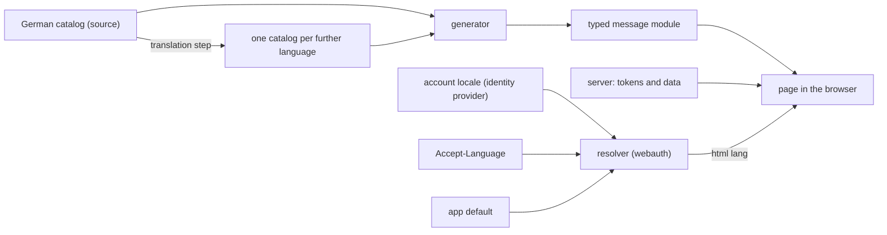

# Languages

The standard by which every app is built so that a further language is added without a
rebuild. Read it when you cut an app's epic for it, build against it or judge an app's
conformance. A rule is cited by its ID, such as `LANG-9`.

This document is a requirement. The shared generator, the kit's words per language,
webauth's hand-off of the account's language and its resolver, the `ui_locales` hint and
quality's rule do not exist yet. The owner's release that ships each one makes the rules that
need it checkable.

Source: the operator's rulings on overnightworks/marketplace#542. A rule marked **ruled**
quotes one; a rule marked **proposed** is this document's proposal, judged by plan review,
and changes with it. A point marked **open with the operator** waits for his ruling (card on
overnightworks/design#162).

**Done** means a further language is a new catalog file and its translations. No code changes.
Around the app it also takes the kit's words for that language, the identity provider's
locale and the legal reading versions: configuration and texts, not code.

## Scope and owners

- **Covered:** every app with a user-facing surface (skat, hopin, songmaker, presentator) and
  the kit (design) for its components' words.
- **design** owns this standard, the generator and the translation step.
- **webauth** owns handing the account's language to the app and the language resolver.
- **quality** owns the check rule that enforces it.
- **platform** owns the legal pages and the identity provider's locales and pages.
- **Speech:** LANG-5 binds speech too; what is open for it is in overnightworks/speech#279.

## How the parts meet

## Requirements

### Ruled

- **LANG-1** (line 1) Each language has one gettext catalog. A generated, typed message
  module is the only way a page reads a text. The server sends message tokens. Checks hold
  all of it.
- **LANG-2** (line 2) A person's language is the account's locale at the identity provider,
  else the browser's. The sign-in wiring hands it to the app. No app stores a person's
  language or offers its own language switch; the person changes it at the identity
  provider's account.
- **LANG-3** (line 3) The kit ships its components' words in every language, the sign-in
  page, the no-access page and the log-out included.
- **LANG-4** (line 5) The German version of a legal text binds. Each further language gets a
  reading version that says so. To be checked legally before the first one ships.

  Open with the operator: whether LANG-6 also covers the reading versions, and whether the
  legal check applies to the approach or to each reading version.
- **LANG-5** (line 6) An agent answers and speaks in the language the person wrote or asked
  in. No app fixes a language for its agents.
- **LANG-6** (added requirement, with a newer word) A model writes each translation once from
  the German source, to the best of its knowledge. No human review is a condition, and no
  check blocks a build for a missing sign-off. A correction comes later as an ordinary
  change. A check fails when a translation is older than its source.
- **LANG-7** (added requirement) Behaviour tests run in one language and find elements by
  catalog key. A further language costs a static catalog check and one render pass per
  surface.

### Proposed: catalogs and texts

- **LANG-8** What is used as is: Babel reads the `.po` files and gives the CLDR plural
  categories per language; the browser's `Intl` and, on script-less pages, Babel format
  numbers, dates and plurals. What is built: one thin generator (several languages, typed
  named gaps, plural families, a TypeScript and a Python module, `--check`) and webauth's
  small resolver (LANG-18). No translation tool and no test helpers. The generator ships in
  design's Python wheel, used at build time only, with Babel as its dependency. The check rule
  that requires it lives in quality (line 7). Libraries weighed and rejected:
  - Paraglide JS: no gettext `.po`, so it fails line 1; Python reads its messages only as raw
    JSON.
  - Lingui: reads `.po` and emits typed modules, but puts ICU syntax into `msgstr`, which
    Python cannot format without a C++ binding, and adds a runtime and macro dependency to
    every app.
  - inlang's CLI: no stale check; its machine translation needs a provider key.

  Also rejected: everything in quality, which gates a build and does not produce the app's
  source; a copy per app, where the copies drift; the resolver in design's wheel, which adds a
  runtime edge to every app server and a webauth-to-design direction, while every app server
  already depends on webauth.

  Open with the operator: the generator's home, in the kit, a small package of its own or a
  copy per app. Proposed: in the kit.
- **LANG-9** A catalog key is a neutral identifier that names what the text is for, never
  the sentence: one namespace level, the surface, then a camelCase name (`table.seatFree`).
  A text on two surfaces gets two keys. The kit's words never enter an app catalog. Renaming
  a key changes every catalog. Rejected: flat keys, which collide at a thousand texts. A
  value is a whole sentence, never assembled from fragments: where it varies, it names its
  gaps (`{name}`), and the typed module types each gap.
- **LANG-10** A language is whole or absent. A key missing from a catalog fails the check;
  no text falls back to another language one by one.
- **LANG-11** Numbers, dates, lists and plural forms go through the browser's `Intl` with the
  page's language; a page without script formats them through Babel in the same language. A
  plural is a family of whole sentences, one per CLDR plural category (`.one`, `.other`).
  One form for the fleet. Rejected: gettext plural forms, which restate rules the CLDR data
  already holds; ICU MessageFormat, a second syntax inside gettext with no maintained Python
  parser for the generator. A catalog's key set equals the source's, except that a plural
  family holds exactly the categories its own language needs (CLDR plural categories, read
  through Babel).
- **LANG-12** The server sends tokens (a catalog key and named values) and data, never a
  sentence for a person. A response may carry a sentence for agents beside the token; the
  page never shows it. Tool descriptions for agents and log lines are not interface text.
- **LANG-13** A text that is stored, such as a failure message in a database, stores its
  token and data, never the sentence; the page renders it in the reader's language.
- **LANG-14** An app has one catalog per language, read by both sides. The server reads it
  only for a page that needs no script (LANG-20), or to test a text, through a Python module
  the generator also emits. Rejected: a second catalog for the server, which doubles the
  source of truth and the freshness check.
- **LANG-15** The generator emits one TypeScript module per language, and the key type comes
  from the source module; where the server sends tokens or a Python test reads texts it also
  emits a Python module. The page loads the module of the language in `<html lang>`, once,
  when it starts. Server tokens are typed against the module's key type, so that every token
  the server can send is a key. Rejected: one module holding every language, which ships
  every language to every person.

### Proposed: the person's language

- **LANG-16** A language tag is BCP 47 in shape. A tag the sign-in wiring cannot parse counts
  as absent, and so does a tag that matches none of the app's languages. The languages an app
  offers are its catalog files, nothing else. Matching is as in LANG-18. Rejected: a fleet
  list of languages, which makes each new language a change to every app.
- **LANG-17** The sign-in wiring hands the app the account's tag as the identity provider
  issued it (its `locale` claim), or a named absence. It does not interpret it.
- **LANG-18** One pure function in webauth owns the order: the account's tag or none, the
  browser's `Accept-Language` header and the app's languages give one of the app's languages.
  It matches by RFC 4647 Lookup (section 3.4) over the account's tag, then the browser's
  weighted list (RFC 9110, section 12.5.4), then the app's default, which is the source
  language unless the app states another. It answers one of the app's own language tags as the
  app spelled it (`de-AT` finds `de`). A tag it cannot parse counts as absent. The sign-in
  page and every page after sign-in call it. webauth owns the ID token's `locale` claim and
  the sign-in request that carries `ui_locales`. Rejected: a copy per app, which parses a
  weighted header four times; design's wheel (LANG-8).
- **LANG-19** The account's tag is read at sign-in. A change at the identity provider takes
  effect at the latest at the next sign-in.
- **LANG-20** The server writes the resolved language into `<html lang>` before any script
  runs. A page that needs no script is served once per language from the same catalog.
- **LANG-21** At sign-in start the app names its resolved language to the issuer as
  `ui_locales` (OpenID Connect Core 1.0, section 3.1.2.1), so the identity provider's own
  pages follow it. Those pages differ from the app's language only when that language is not
  among the realm's supported locales; adding a language adds it there (platform).

### Proposed: kit, content, source and freshness

- **LANG-22** The kit's components take the page's language and bring their words for it.
  A component learns the page's language from `<html lang>` unless the app passes it. The kit
  exposes the list of languages it ships, so an app's check can compare; the details are the
  kit's. An app's check fails when the kit lacks a language the app offers. The kit's own
  conversion is a separate epic that follows this document.
- **LANG-23** Content never follows the interface language: lyrics, slides, chat messages
  and names. Where an app needs content's own language (for example to mark a span with
  `lang`), the content carries a tag of its own. An agent's reply follows the message that
  caused it (LANG-5); where no message did, such as a click, the app passes the person's
  interface language to the agent. That is no language rule inside the agent's prompt.
- **LANG-24** German is the source language (LANG-6). An app whose texts are English today
  converts to a German source or asks for a deviation (see Deviations). Only the operator
  rules a deviation. Wherever this document says "the German catalog" or "the source", an
  app with a ruled deviation reads its own source catalog.
- **LANG-25** A catalog entry is gettext's standard shape: the neutral key in `msgctxt`, the
  source text in `msgid`, the translation in `msgstr`. The source language's file holds the
  key and the text once, in the form Babel's catalog update handles; the generator fixes it.
  Freshness is gettext's own: the update marks an entry fuzzy when its source text changes,
  and the check is no fuzzy and no empty entry. Here fuzzy means "stale, to be re-translated",
  not "awaits a human" (LANG-6). The agent that changes a source text writes the translation
  and clears the mark in the same change; nothing needs a network, key or provider, and the
  committed catalog is the build's input. The remaining risk: clearing the mark without
  translating defeats the check, which is an aid for cooperative agents. Standard gettext
  tools read the catalogs.

  Open point, settled by the generator's first slice with a small trial before a second
  language ships: a language whose plural categories differ from the source's (LANG-11) must
  survive the update. If it does not, the fallback is a recorded source hash per entry, a
  translator comment `# source: sha256:<hex>` over the source text normalised to NFC UTF-8.
- **LANG-26** Legal texts follow LANG-4. platform owns the pages and each reading version.
- **LANG-27** (added) Catalogs live at `frontend/src/lib/catalogs/<tag>.po` (skat's layout);
  generated modules sit beside the code that imports them. Each repository declares both in
  one place that the generator and quality's rule read; the declaration's form is the
  generator's.
- **LANG-28** (added) The rule for new text: no new literal sentence in markup, no sentence
  from the server. Literal strings in script (toasts, confirm dialogs) are bound by it too,
  but no machine catches them; the scheduled audit finds them.

## Tests and checks

One question governs this section: what does a further language add that a test must see?

- **Behaviour tests run in the source language.** A behaviour test never finds an element by
  a literal; the expected text comes from the generated module of the source language, by
  key. No app parses a catalog in a test, and no test helper ships.
- **One owner per check.** The generator's `--check` holds all catalog validity and runs in
  the app's own lint and in CI:
  - the key set equals the source's, except for plural families (LANG-11);
  - each value's named gaps equal the source's, and no key is missing (LANG-10);
  - no entry is fuzzy or empty (LANG-25);
  - the generated modules are current;
  - the kit ships every language the app offers (LANG-22).

  The type check holds the rest of the key contract: server tokens are typed against the
  module's key type (LANG-15).
- **quality's rule** (a) requires the `--check` in the app's CI and the render pass below, and
  (b) owns the scan for literal text in markup, in a text or in a human-readable attribute
  (presentator's `scripts/check_catalog_purity.py` is the reference), with a baseline that
  only shrinks.
- **The render pass.** An automated test of the app that runs in CI on every change, per
  further language, at the mobile and the desktop width. It asserts that no catalog key
  appears as text, `<html lang>` equals the language, and no text element's scroll width
  exceeds its client width unless it scrolls by design. quality requires its presence. A
  delegated agent drives the surfaces once when a language is added.
- **Tested once, outside the app:** the resolver (LANG-18), the generator and the freshness
  check. An app tests only that it calls the resolver and writes `<html lang>`.
- **Not tested per language:** flows, permissions, state, and the output of `Intl` and Babel.
  The wording of a translation is corrected later as an ordinary change (LANG-6).

## Adoption trigger

**Ruled (line 4):** every covered app holds an epic. Apps that can convert quickly do so now.
songmaker starts too.

**Proposed:** design ships the shared generator first (skat's generator moved into design
and widened to LANG-9 to LANG-11). An app's first catalog slice follows that release, and no
app extends a generator of its own meanwhile. An app may start these slices before that
release: server sentences to tokens against a typed key list, one owner for the date and
sort locale, and fragment-built sentences converted to whole sentences where a catalog
already exists. The rule for new text (LANG-28) binds from an app's first catalog slice; new
texts are collected in one named constants owner until then.

Open with the operator: whether the rule for new text binds at once, or from an app's first
catalog slice as proposed.

An app's slices after the first convert the surfaces and the server's sentences into
tokens, then add the first further language.

## Deviations

A deviation is asked for at design, as marketplace's `docs/standards.md` ("How a standard
works") requires. The request names enduring harm: a lost capability, recurring upkeep, an
unmet operational constraint or a credible risk, with its uncertainty stated. design's head
reviews it. Only the operator rules it, and the ruling is recorded here.

Ruled today (source: songmaker#2976, line 1): songmaker keeps English as its source
catalog, and German is generated from it as its first added language. Its keys are neutral
identifiers (LANG-9), so the source can change later without a code change. For any other
app whose texts are English today, nothing is ruled: German as the source stands until the
operator rules a deviation.
